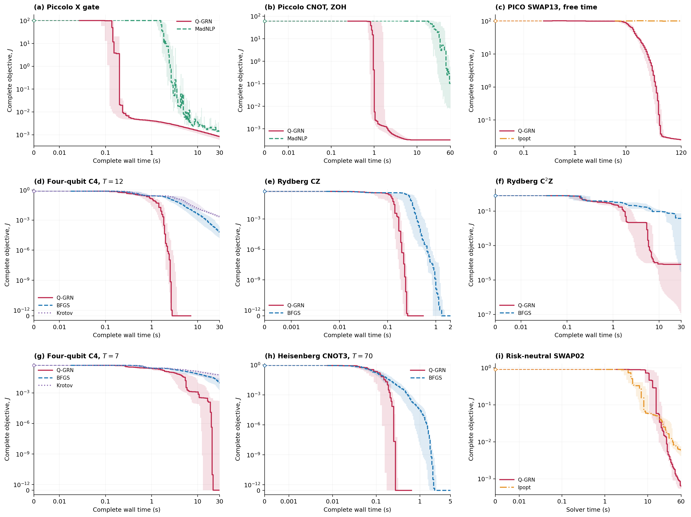

# Q-GRN: Quantum Gradient-Regularized Newton

A structured nonlinear optimizer for quantum-control trajectories, with nine
reproducible benchmark problems.

Q-GRN combines feasible trajectory coordinates, sparse control constraints,
low-rank Gauss-Newton curvature, and adaptive gradient regularization. The core
Python package depends on NumPy and SciPy. Benchmark adapters provide the quantum
models and comparisons with native Ipopt and MadNLP, an independent BFGS
implementation, and a DYNAMO Krotov translation.

[Releases and downloads](https://github.com/huwei0121/qgrn/releases) ·
[API](docs/api.md) · [Algorithm](docs/algorithm.md) ·
[Benchmark reproduction](reproduction/README.md)

## Install and solve

Python 3.10 or later is required.

~~~console
git clone https://github.com/huwei0121/qgrn.git
cd qgrn
python -m pip install .
python examples/qgrn_gate_control.py
~~~

The example optimizes an X gate using exact matrix exponentials and Fréchet
derivatives. Julia, MATLAB, and quantum hardware are unnecessary for this example.

For a least-squares problem, supply the residual and its Jacobian:

~~~python
import numpy as np
from qgrn import Options, ResidualProblem, minimize

problem = ResidualProblem(
    residual=lambda x: np.array([10 * (x[1] - x[0] ** 2), 1 - x[0]]),
    jacobian=lambda x: np.array([[-20 * x[0], 10], [-1, 0]]),
)
result = minimize(problem, [-1.2, 1.0], Options(time_limit=5, max_iterations=100))
print(result.fun, result.status)
~~~

The [model contracts](docs/api.md) describe sparse constraints, objective and
derivative conventions, feasible initialization, solver options, and results.

## Reproduce the benchmarks

The repository and reproduction ZIP contain all nine models, their comparison
methods, exact paired inputs, recorded candidate curves, and plotting code.
Native Julia dependencies are installed separately from pinned manifests.

~~~console
python -m pip install -e ".[plots]"
python reproduction/reproduce.py verify
python reproduction/reproduce.py plot --output outputs/reference
python reproduction/reproduce.py run --plan
~~~

The first two reproduction commands verify the saved records and redraw the
figures without rerunning optimization. To check the Python runtime:

~~~console
python reproduction/reproduce.py run --problems jandura_cz --methods qgrn bfgs --seeds 85201 --seconds 0.2 --output outputs/cz_smoke
~~~

See the [reproduction guide](reproduction/README.md) for the complete setup,
native Julia versions, all-method smoke tests, parallel execution, and resuming
a run.

| Problem | Control structure | Comparison methods |
| --- | --- | --- |
| Piccolo X | Free time, control derivative chain, hardware bounds | MadNLP |
| Piccolo CNOT | Two-qubit trajectory with hardware bounds | MadNLP |
| PICO SWAP13 | Three-qubit Padé trajectory and free time | Ipopt |
| Machnes C4, T = 12 | Four-qubit terminal gate control | BFGS, Krotov |
| Jandura CZ | Rydberg phase control | BFGS |
| Jandura C²Z | Three-qubit Rydberg phase control | BFGS |
| Machnes C4, T = 7 | Shorter physical time with the same control dimension | BFGS, Krotov |
| Heule CNOT3 | Alternating local control of a spin chain | BFGS |
| Risk-neutral SWAP02 | Nine uncertainty scenarios and path leakage | Ipopt |

Each problem is tested with ten random seeds. All methods within a problem use
the same initial conditions, giving 90 paired inputs and 200 runs.
[Configurations](reproduction/configs/selected.json) and
[data provenance](reproduction/data/provenance.json) record the exact inputs
and reference data.

Plots show the original physical objective, using a common feasibility recovery
for incomplete collocation trajectories. Shortening a stable plotted tail does
not change the stored samples or full-budget statistics. See the
[model definitions](reproduction/docs/models.md) for equations, constraints,
source versions, and baseline settings.

## Package layout

| Path | Contents |
| --- | --- |
| `src/qgrn` | Solver, options, results, geometry, constraints, and directions |
| `src/qgrn_benchmarks` | Physical models, baselines, native bridges, and analysis |
| `reproduction` | Fixed configurations, inputs, data, environments, and commands |
| `docs` | API, algorithm, installation, and development documentation |
| `examples` | Standalone X-gate example |
| `tests` | Numerical and reproducibility checks |
| `tools` | Distribution inspection and source/data export |

## Development

~~~console
python -m pip install -e ".[dev,plots]"
python -m pytest
python -m build
python tools/check_distribution.py dist
~~~

The wheel contains the solver. The source distribution adds documentation,
the example, and solver tests. The reproduction ZIP adds the benchmark software
and data. Each reproduction distribution has a SHA-256 file manifest;
release archives have separate checksums.

See [development](docs/development.md) for interface conventions and validation,
and [references](docs/references.md) for method and model sources.

## License

Q-GRN is licensed under BSD-3-Clause. The benchmark DYNAMO translation retains
LGPL-3.0-only; bundled Julia sources retain their own licenses. Full notices and
license texts are listed in
[THIRD_PARTY_NOTICES](reproduction/THIRD_PARTY_NOTICES.md).
